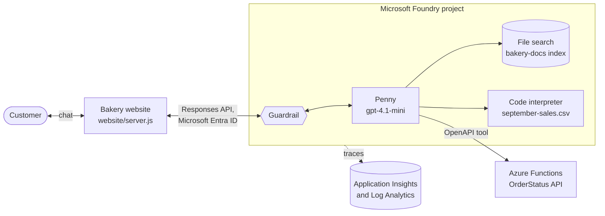

# Build your first AI agent on Azure

**From an empty Azure subscription to an AI agent on your own website.** Sample files for part 1
of the Blue Penguin Bakery series on the Infra2AI YouTube channel, where we build **Penny**, an AI
assistant for a fictional bakery, in Microsoft Foundry.

**Watch:** [the video](https://www.youtube.com/watch?v=5beCrJJskUk) ·
[the whole series](https://www.youtube.com/playlist?list=PLUKvmDqPth-M) ·
**Part 2 code:** [infra2ai/rag-on-azure](https://github.com/infra2ai/rag-on-azure)

## What you build

Penny can:

- answer questions from the bakery's documents (*File search*)
- analyse a sales spreadsheet and draw charts (*Code interpreter*)
- check the status of an order by calling the bakery's own API, built with Azure Functions
  (*OpenAPI tool*)
- refuse jailbreak attempts (*guardrails*), with every step she takes visible in *traces*
- chat with customers on the bakery's own website, without an API key

No AI or Azure experience needed: every click is shown in the video.

## The series

| Part | Video | What Penny learns | Code |
|---|---|---|---|
| 1 | [Build your first AI agent on Azure](https://www.youtube.com/watch?v=5beCrJJskUk) | Answers from files, analyses data with code, calls the bakery's order API, guardrails, tracing, and her own website | This repository |
| 2 | Azure AI Search for AI agents | Searches all of the bakery's documents, always up to date | [infra2ai/rag-on-azure](https://github.com/infra2ai/rag-on-azure) |
| 3 | Coming next: multiple agents | Hands cake and catering orders to a teammate, the Orders agent | |

All videos are in the [series playlist](https://www.youtube.com/playlist?list=PLUKvmDqPth-M).

## How it works



1. A question arrives from the website, the Foundry playground, or the web app preview. The
   **guardrail** checks it on the way in, and checks Penny's answer on the way out
   ([Guardrails and controls](https://learn.microsoft.com/en-us/azure/foundry/guardrails/guardrails-overview)).
2. The model reads Penny's **instructions** and the question, and decides which tools to use. One
   question can need several:
   - **File search** finds the right passages in the bakery's documents
     ([File search](https://learn.microsoft.com/en-us/azure/foundry/agents/how-to/tools/file-search))
   - the **Code interpreter** writes Python and runs it on the sales data, in a sandbox
     ([Code interpreter](https://learn.microsoft.com/en-us/azure/foundry/agents/how-to/tools/code-interpreter))
   - the **OpenAPI tool** calls the order API. Its OpenAPI description tells Penny what the API
     can do and what to send ([OpenAPI tool](https://learn.microsoft.com/en-us/azure/foundry/agents/how-to/tools/openapi))
3. Every step is recorded as a **trace** in Application Insights, so you can see what Penny did,
   and why ([Tracing](https://learn.microsoft.com/en-us/azure/foundry/observability/concepts/trace-agent-concept)).
4. The website sends only the question and the agent's name to the **Responses API**. The
   instructions, the tools and the guardrail all live in Foundry, so you can improve Penny without
   touching the website ([Use the Responses API](https://learn.microsoft.com/en-us/azure/foundry/agents/quickstarts/responses-api)).

## What is in this repository

| Path | Contents | Used in the video for |
|---|---|---|
| [`agent/instructions.txt`](agent/instructions.txt) | Penny's instructions | Creating the agent |
| [`data/bakery-docs/`](data/bakery-docs) | Six short bakery documents: returns, opening hours, delivery, allergies, menu and prices, custom cakes | Knowledge: *Upload files* |
| [`data/september-sales.csv`](data/september-sales.csv) | September's sales, one row per product per opening day (date, product, units sold, unit price in CHF) | Code interpreter: *Files* |
| [`function/`](function) | The `OrderStatus` Azure Function (JavaScript), with its `function.json` and `host.json` | The order API |
| [`openapi/bakery-orders.json`](openapi/bakery-orders.json) | OpenAPI 3.0 description of the order API | Adding the API as a tool |
| [`website/`](website) | A small bakery website with an *Ask Penny* chat that calls the agent (`server.js`, `index.html`, `package.json`) | Penny on your own website |

Blue Penguin Bakery is fictional, and so is everything in its documents and orders.

## What you need

- An Azure subscription where you can create resources, and the **Foundry User** role (or higher)
  on the Foundry resource to work with agents. If you can assign roles (for example, as an
  Owner) and create the Foundry resource in the portal, as in the video, you get this role
  automatically. Microsoft recently renamed it; you may still see its old name, *Azure AI User*
  ([Foundry roles](https://learn.microsoft.com/en-us/azure/foundry/concepts/rbac-foundry)).
- Only to run the website on your computer: **Node.js 22 or later** and the
  [Azure CLI](https://learn.microsoft.com/en-us/cli/azure/install-azure-cli).

The video uses the Switzerland North region for everything. Not every tool is available in every
region, so check [tool support by region](https://learn.microsoft.com/en-us/azure/foundry/agents/concepts/limits-quotas-regions#tool-support-by-region-and-model)
if you pick another one.

## What it costs

- **gpt-4.1-mini**: billed per token. The questions in the video cost a few cents
  ([pricing](https://azure.microsoft.com/en-us/pricing/details/azure-openai/)).
- **File search**: vector storage is billed per GB per day, and the first GB is free; six short
  files use a tiny part of it. **Code interpreter**: billed per session
  ([Foundry Agent Service pricing](https://azure.microsoft.com/en-us/pricing/details/foundry-agent-service/)).
- **Azure Functions, Consumption plan**: a monthly free grant of 1 million requests per
  subscription, plus a few cents for the storage account the Function App needs
  ([pricing](https://azure.microsoft.com/en-us/pricing/details/functions/)).
- **Log Analytics and Application Insights**: billed per GB of data, and the first 5 GB a month
  per billing account are free ([pricing](https://azure.microsoft.com/en-us/pricing/details/monitor/)).

Following along costs well under a dollar, as long as you delete the resource group at the end
(see [Clean up](#clean-up)).

## Step by step

Each step links to the moment in the video where we do it.

1. **Create the resources** ([▶ 5:12](https://www.youtube.com/watch?v=5beCrJJskUk&t=312s)). In
   the Azure portal, create a resource group (`rg-bakery-agent` in the video) and a
   **Microsoft Foundry** resource in it. Foundry also creates your first project, `proj-default`.
   Then click **Go to Foundry portal**.
   ([Set up Foundry resources](https://learn.microsoft.com/en-us/azure/foundry/tutorials/quickstart-create-foundry-resources))
2. **Deploy a model** ([▶ 7:35](https://www.youtube.com/watch?v=5beCrJJskUk&t=455s)). In the
   Foundry portal, click **Explore models**, find `gpt-4.1-mini`, and deploy it with the default
   settings. The catalog marks it as legacy: it retires on 14 April 2027. After that, pick a newer
   GPT model; the rest of the steps stay the same.
   ([Deploy models](https://learn.microsoft.com/en-us/azure/foundry/foundry-models/how-to/deploy-foundry-models),
   [retirement schedule](https://learn.microsoft.com/en-us/azure/foundry/openai/concepts/model-retirement-schedule))
3. **Create the agent** ([▶ 9:09](https://www.youtube.com/watch?v=5beCrJJskUk&t=549s)). In
   *Build > Agents*, click **New agent > Build an agent**, name it `penny`, and click
   **Create agent and open playground**. Paste [`agent/instructions.txt`](agent/instructions.txt)
   into *Instructions*, remove the default *Web search* tool, and click **Save**.
   ([Create a prompt agent](https://learn.microsoft.com/en-us/azure/foundry/agents/quickstarts/prompt-agent))
4. **Add knowledge** ([▶ 13:20](https://www.youtube.com/watch?v=5beCrJJskUk&t=800s)). Under
   *Tools*, choose **Upload files**, name the vector index `bakery-docs`, add the six files in
   [`data/bakery-docs/`](data/bakery-docs), and click **Attach**. Penny gets a *File search* tool
   connected to the index. Click **Save**, then ask *Can I return a cake for cash? I bought it three
   days ago.* Her answer cites `return-policy.txt`. How this works, with embeddings, is explained at
   [▶ 11:34](https://www.youtube.com/watch?v=5beCrJJskUk&t=694s).
   ([File search](https://learn.microsoft.com/en-us/azure/foundry/agents/how-to/tools/file-search),
   [vector stores](https://learn.microsoft.com/en-us/azure/foundry/agents/concepts/vector-stores))
5. **Add the code interpreter** ([▶ 16:48](https://www.youtube.com/watch?v=5beCrJJskUk&t=1008s)).
   Under *Tools*, click **Add > Code interpreter**, then **Files**. Upload
   [`data/september-sales.csv`](data/september-sales.csv), click **Attach**, and **Save**. Ask
   *Which product earned the most money in September? Draw a bar chart of revenue by product.*
   The chart comes back as a file: click it to open it.
   ([Code interpreter](https://learn.microsoft.com/en-us/azure/foundry/agents/how-to/tools/code-interpreter))
6. **Create the Function App** ([▶ 20:19](https://www.youtube.com/watch?v=5beCrJJskUk&t=1219s)).
   In the Azure portal, create a **Function App** in the same resource group:
   - *Hosting*: **Consumption (Windows)**, and confirm when Azure suggests Flex Consumption. Flex
     Consumption is the recommended plan for real projects, but it can't edit code in the browser
     ([portal editing limits](https://learn.microsoft.com/en-us/azure/azure-functions/functions-how-to-use-azure-function-app-settings#development-limitations-in-the-azure-portal)).
   - *Runtime stack*: **Node.js**, version **22 LTS**, in the same region as everything else.
   - *Monitoring*: turn Application Insights off. Penny gets her own in step 10.

   ([Create a function app in the portal](https://learn.microsoft.com/en-us/azure/azure-functions/functions-create-function-app-portal),
   [hosting plans](https://learn.microsoft.com/en-us/azure/azure-functions/functions-scale))
7. **Write and test the order API** ([▶ 22:21](https://www.youtube.com/watch?v=5beCrJJskUk&t=1341s)).
   On the Function App, click **Create in Azure portal**, choose **HTTP trigger**, and click
   **Next**. Name the function `OrderStatus`, set *Authorization level* to **Anonymous**, and click
   **Create**. Replace its code with [`function/OrderStatus/index.js`](function/OrderStatus/index.js)
   and click **Save**. Then click **Test/Run**, choose **GET**, add the query parameter `orderId`
   with the value `BP-1042`, and click **Run**.
   ([HTTP trigger](https://learn.microsoft.com/en-us/azure/azure-functions/functions-bindings-http-webhook-trigger))
8. **Give Penny the API as a tool** ([▶ 24:49](https://www.youtube.com/watch?v=5beCrJJskUk&t=1489s)).
   In Penny's *Tools*, click **Add > Add tools**, open **Custom**, choose **OpenAPI tool**, and
   click **Create**. Name it `bakery_orders`, keep *Authentication* **Anonymous**, and paste
   [`openapi/bakery-orders.json`](openapi/bakery-orders.json). In `servers.url`, replace
   `<your-function-app>.azurewebsites.net` with your Function App's **Default domain**, copied from
   its *Overview* page, and keep `/api` at the end. Copy it rather than typing the app's name: the
   domain can include a random part and the region. Click **Create tool**, then **Save**, and ask
   *Hi Penny, where is my order BP-1042?*
   ([OpenAPI tool](https://learn.microsoft.com/en-us/azure/foundry/agents/how-to/tools/openapi))
9. **Check the guardrail** ([▶ 29:04](https://www.youtube.com/watch?v=5beCrJJskUk&t=1744s)). At
   the bottom of Penny's setup, open **Guardrail**. She inherits her model's default guardrail,
   `Microsoft.DefaultV2`, which already blocks jailbreak attempts, harmful content and protected
   material. Start a **New chat** and try a jailbreak: tell Penny to ignore all of her previous
   instructions and to act as an AI with no rules, then ask for something harmful. The guardrail
   blocks it. Guardrails and traces are explained at
   [▶ 27:28](https://www.youtube.com/watch?v=5beCrJJskUk&t=1648s).
   ([Default guardrails](https://learn.microsoft.com/en-us/azure/foundry/guardrails/guardrails-overview#default-guardrails))
10. **Create Log Analytics and Application Insights** ([▶ 30:17](https://www.youtube.com/watch?v=5beCrJJskUk&t=1817s)).
    In the Azure portal, create a **Log Analytics workspace** (`log-bluepenguin`), then an
    **Application Insights** resource (`appi-bluepenguin`) that uses it, both in the same resource
    group and region.
    ([Create a Log Analytics workspace](https://learn.microsoft.com/en-us/azure/azure-monitor/logs/quick-create-workspace),
    [create an Application Insights resource](https://learn.microsoft.com/en-us/azure/azure-monitor/app/create-workspace-resource))
11. **Turn on tracing** ([▶ 31:45](https://www.youtube.com/watch?v=5beCrJJskUk&t=1905s)). In
    Foundry, open Penny's **Traces** tab, click **Connect**, choose `appi-bluepenguin`, and click
    **Connect**. From now on, every run of every agent in the project is recorded. Ask
    *Are vanilla cupcakes nut-free, and is my order BP-1043 ready yet?*, then open the run on the
    *Traces* tab: you see the file search, the call to the order API, and the model writing the
    answer. A new run can take a minute to appear.
    ([Set up tracing](https://learn.microsoft.com/en-us/azure/foundry/observability/how-to/trace-agent-setup))
12. **Preview Penny as a web app** ([▶ 33:52](https://www.youtube.com/watch?v=5beCrJJskUk&t=2032s)).
    Open **Publish > Preview web app**: a ready-made chat page for Penny, hosted by Foundry.
    **Share** gives you a link for colleagues who have access to the project, and **Code** links to
    a sample app on GitHub.
    ([Configure and share your agent](https://learn.microsoft.com/en-us/azure/foundry/agents/how-to/configure-agent))
13. **Put Penny on your own website** ([▶ 35:09](https://www.youtube.com/watch?v=5beCrJJskUk&t=2109s)):
    see [Run the website locally](#run-the-website-locally).

## Run the website locally

```bash
cd website
npm install
az login
export PROJECT_ENDPOINT="https://<foundry-resource>.services.ai.azure.com/api/projects/<project>"
export AGENT_NAME="penny"
npm start
```

In Windows PowerShell, set the variables with `$env:PROJECT_ENDPOINT = "..."` and
`$env:AGENT_NAME = "penny"` instead.

Open http://localhost:3000 and click **Ask Penny**.

- The project endpoint is shown on the project's home page in the Foundry portal.
- The server signs in with Microsoft Entra ID through `DefaultAzureCredential`, here with your
  `az login`, so there's no API key anywhere in the code. Your account needs the Foundry User
  role ([how DefaultAzureCredential works](https://learn.microsoft.com/en-us/azure/developer/javascript/sdk/authentication/credential-chains)).
- *How it works* shows the request the website sends (only the question and the agent's name) and
  the steps Penny took.

## Troubleshooting

| What you see | What to do |
|---|---|
| The Function App has no code editor, or no *Create in Azure portal* | Apps on Flex Consumption, or on Linux, can't edit JavaScript in the browser. Create the app on **Consumption (Windows)**, as in step 6 ([portal editing limits](https://learn.microsoft.com/en-us/azure/azure-functions/functions-how-to-use-azure-function-app-settings#development-limitations-in-the-azure-portal)). |
| The chat won't take the sales CSV | Upload it under **Code interpreter > Files** (step 5), not with the paperclip in the chat. |
| The chart doesn't show in the chat | It comes back as a file. Click the file name to open it. |
| Penny says she can't check orders, or no `openapi_call` step appears | Open `https://<default-domain>/api/OrderStatus?orderId=BP-1042` in your browser: it should return the order as JSON. Then check that `servers.url` in the tool is exactly that address, up to and including `/api`, and that the function's authorization level is *Anonymous*. |
| The *Traces* tab shows no runs | A new run can take a minute to appear, so refresh the page. Check that Application Insights is connected (step 11). |
| The website shows a sign-in or token error | Run `az login`, then ask again. |
| The website shows *Foundry returned HTTP 403* | Your account needs the **Foundry User** role on the Foundry resource. A new role assignment can take a few minutes to apply. |
| The website shows another *Foundry returned HTTP* error | Check `PROJECT_ENDPOINT` (the project endpoint, ending in `/api/projects/<project>`) and `AGENT_NAME` (`penny`). |
| You can't create a Foundry resource with a name you used before | A deleted Foundry resource is kept for 48 hours. Purge it, or choose another name (see [Clean up](#clean-up)). |

## Before you use this for real

The video ends with four things to do before production
([▶ 38:16](https://www.youtube.com/watch?v=5beCrJJskUk&t=2296s)):

- **Protect the API.** The order API allows anonymous access to keep the demo simple. Protect a
  real API with a function key, which the OpenAPI tool sends as an API key from a project
  connection, or with Microsoft Entra ID, using the Foundry resource's managed identity
  ([OpenAPI tool authentication](https://learn.microsoft.com/en-us/azure/foundry/agents/how-to/tools/openapi#choose-an-authentication-method),
  [securing Azure Functions](https://learn.microsoft.com/en-us/azure/azure-functions/security-concepts)).
- **Describe your tools well.** The model chooses a tool from its name and description, so give
  every operation a clear `operationId` and `description`
  ([OpenAPI tool limitations](https://learn.microsoft.com/en-us/azure/foundry/agents/how-to/tools/openapi#understand-limitations)).
- **Test with evaluations.** Ask the same set of questions after every change, and compare the
  answers ([Evaluate agents](https://learn.microsoft.com/en-us/azure/foundry/observability/how-to/evaluate-agent)).
- **Watch the traces and the cost.** Check what the agent did, and set a budget alert
  ([Create a budget](https://learn.microsoft.com/en-us/azure/cost-management-billing/costs/tutorial-acm-create-budgets)).

Two more for this sample:

- **Use real data.** The orders are hard-coded in the function. A real API reads them from a
  database.
- **Host the website on Azure.** It only listens on your own computer. Run it on Azure, for
  example on App Service, with a
  [managed identity](https://learn.microsoft.com/en-us/entra/identity/managed-identities-azure-resources/overview)
  instead of your own sign-in: `DefaultAzureCredential` picks it up without code changes. For the
  least access, change `server.js` to call the agent's own endpoint, which needs only the
  **Foundry Agent Consumer** role
  ([Configure and share your agent](https://learn.microsoft.com/en-us/azure/foundry/agents/how-to/configure-agent)).

## Clean up

Delete the resource group when you're done
([▶ 36:42](https://www.youtube.com/watch?v=5beCrJJskUk&t=2202s)). It removes everything from the
video: the Foundry resource and its project, the Function App with its plan and storage account,
the Log Analytics workspace, and Application Insights.

Going straight on to [part 2](https://github.com/infra2ai/rag-on-azure)? It starts from Penny, so
keep the resource group until you've finished it. Everything in it is billed by use, apart from a
few cents of storage.

A deleted Foundry resource is kept for 48 hours, and its name can't be reused until then. To
create a new one with the same name sooner, purge it
([Recover or purge deleted Foundry resources](https://learn.microsoft.com/en-us/azure/ai-services/recover-purge-resources)).

## Learn more

- [What is Foundry Agent Service?](https://learn.microsoft.com/en-us/azure/foundry/agents/overview)
- Tools: [File search](https://learn.microsoft.com/en-us/azure/foundry/agents/how-to/tools/file-search),
  [Code interpreter](https://learn.microsoft.com/en-us/azure/foundry/agents/how-to/tools/code-interpreter)
  and [OpenAPI](https://learn.microsoft.com/en-us/azure/foundry/agents/how-to/tools/openapi)
- [Guardrails and controls](https://learn.microsoft.com/en-us/azure/foundry/guardrails/guardrails-overview),
  [tracing](https://learn.microsoft.com/en-us/azure/foundry/observability/concepts/trace-agent-concept)
  and [evaluating agents](https://learn.microsoft.com/en-us/azure/foundry/observability/how-to/evaluate-agent)
- [Use the Responses API](https://learn.microsoft.com/en-us/azure/foundry/agents/quickstarts/responses-api)
  and [configure and share your agent](https://learn.microsoft.com/en-us/azure/foundry/agents/how-to/configure-agent)
- [Azure Functions overview](https://learn.microsoft.com/en-us/azure/azure-functions/functions-overview)
  and [hosting plans](https://learn.microsoft.com/en-us/azure/azure-functions/functions-scale)
- [Quotas, limits and region support for Foundry Agent Service](https://learn.microsoft.com/en-us/azure/foundry/agents/concepts/limits-quotas-regions)

## Next

Penny's knowledge came from six files uploaded straight to the agent, which is the quickest way to
start. But real companies have thousands of documents, and they keep changing. In part 2 the
bakery grows, and Penny gets a real search engine: **Azure AI Search**. The code is in
[infra2ai/rag-on-azure](https://github.com/infra2ai/rag-on-azure), and the video is in the
[series playlist](https://www.youtube.com/playlist?list=PLUKvmDqPth-M).
